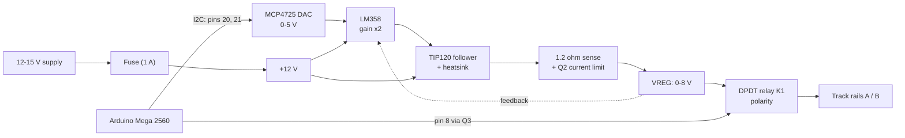

# Proposed Design: Smooth DC Track Supply

Status: proposed, not built. Replaces the PWM track drive (L298N #1, pins 5 and 6) with a DAC-controlled linear supply and a relay for polarity. The turnout drive (L298N #2) and sensors are unchanged. See [system-setup.md](system-setup.md) for the current setup.

## 1. Goal

Supply the track with steady DC instead of PWM, to avoid the brush arcing and noise that PWM drive can add, while keeping the same serial protocol and speed ramping.

## 2. Design summary

- An MCP4725 DAC (0–5 V, I2C) sets the speed.
- An LM358 op-amp with gain of 2 drives a TIP120 Darlington as an emitter follower, giving 0 to about 8 V.
- A current-limit transistor (Q2) with a 1.2 Ω sense resistor limits the output to about 0.5 A.
- A DPDT relay reverses the track polarity. It switches only when the output is 0 V.
- The Arduino controls the DAC over I2C (pins 20 and 21) and the relay from pin 8.



## 3. Parts list

| Qty | Part | Notes |
|---|---|---|
| 1 | MCP4725 breakout board | 12-bit I2C DAC. Check the I2C address (0x60–0x62). |
| 1 | LM358 (DIP-8) + socket | Dual op-amp, input range includes 0 V |
| 1 | TIP120 (TO-220) | Darlington NPN power transistor |
| 1 | TO-220 heatsink (≤ 6 °C/W) + insulating pad and shoulder washer | The TIP120 tab is the collector at +12 V |
| 2 | 2N2222 / PN2222 (TO-92) | Q2 current limit, Q3 relay driver |
| 1 | 5 V DPDT signal relay (for example Omron G5V-2) | Contacts rated ≥ 1 A |
| 1 | 1N4007 or 1N4148 diode | Relay flyback |
| 2 | 10 kΩ ¼ W resistor (1% preferred) | Gain network |
| 1 | 470 Ω ¼ W resistor | Q1 base |
| 2 | 1 kΩ ¼ W resistor | Output bleed, relay driver base |
| 1 | 1.2 Ω 1 W resistor | Current sense |
| 1 | 100 pF ceramic capacitor | Loop stability |
| 2 | 100 nF ceramic capacitor | Decoupling |
| 1 | 100 µF 25 V electrolytic capacitor | Supply bulk |
| 1 | 12 V 2 A DC supply | Reuse the current supply if rated ≥ 1 A |
| 1 | 1 A fuse or polyfuse | +12 V input |
| – | Perfboard or breadboard, terminal blocks, wire | |

## 4. Connections

All grounds are common (Arduino, supply, and every GND below).

**MCP4725**
- VCC → Mega 5 V, GND → GND, SDA → pin 20, SCL → pin 21
- OUT → LM358 pin 3

**LM358 (U1)**
- Pin 8 → +12 V, with a 100 nF capacitor to GND
- Pin 4 → GND
- Pin 3 (+input A) ← DAC OUT
- Pin 2 (−input A) ← feedback node
- Pin 1 (output A) → 470 Ω → Q1 base
- Unused amplifier B: pin 5 → GND, pin 6 → pin 7

**Feedback (gain of 2)**
- 10 kΩ (Rf) from VREG to LM358 pin 2
- 10 kΩ (Rg) from LM358 pin 2 to GND
- 100 pF in parallel with Rf

**Power stage**
- Q1 (TIP120): collector → +12 V, base ← 470 Ω, emitter → 1.2 Ω resistor
- The other end of the 1.2 Ω resistor is VREG.
- 100 µF from +12 V to GND, close to Q1
- 1 kΩ bleed resistor from VREG to GND

**Current limit (Q2)**
- Base → Q1 emitter (Q1 side of the 1.2 Ω resistor)
- Emitter → VREG
- Collector → Q1 base

**Relay (K1) and driver (Q3)**
- Coil + → Mega 5 V, coil − → Q3 collector
- Q3 emitter → GND, Q3 base ← 1 kΩ ← Mega pin 8
- 1N4007 across the coil (cathode to 5 V, anode to Q3 collector)
- NC_A → VREG, NO_A → GND, NC_B → GND, NO_B → VREG
- COM_A → track rail A, COM_B → track rail B

The relay de-energised gives rail A = +V, rail B = GND. Energised swaps them.

## 5. Schematic sketch

```
                    +12V ──┬───────────────┬───────────┐
                           │              [100µF]      │
                           │               │           │
                           │              GND          C
                           │                      Q1 TIP120
 Mega 5V ─ MCP4725         │            ┌──470Ω──── B
   SDA(20) ─ SDA           │            │           E
   SCL(21) ─ SCL           │            │           │
              OUT ───┐     │            │           ├──────── Q2 base
                     │   ┌─8────┐       │          [1.2Ω]
                     └──3+      1──────┘           │
                       │ LM358  │         Q2 emitter┴── VREG ──┬─ [1kΩ] ─ GND
                  ┌────2−      │      (Q2 collector → Q1 base)  │
                  │    └─4──────┘                                │
                  │      │                                      │
                  │     GND                                     │
                  ├──[10k Rg]── GND                             │
                  └──[10k Rf ‖ 100pF]───────────────────────────┤
                                                                │
   Mega pin 8 ─[1k]─ Q3 base                                    │
   Q3 collector ── relay coil ── Mega 5V   (1N4007 across coil) │
   Q3 emitter ── GND                                            │
                                                                │
   Relay K1 (DPDT)                                              │
     NC_A ──────────────────────────────────────────────────── VREG
     NO_A ── GND
     NC_B ── GND
     NO_B ──────────────────────────────────────────────────── VREG
     COM_A ── Track rail A
     COM_B ── Track rail B
```

## 6. Calculations

- **Output voltage:** $V_{out} = 2 \times V_{DAC}$.
- **Maximum output:** About 8.5 V. The LM358 output reaches about 10.5 V on a 12 V supply, minus roughly 1.5 V for the TIP120 base-emitter drop and about 0.4 V across the sense resistor at 0.3 A. Cap the DAC at about 4 V (code ≈ 3276), giving about 8 V.
- **Current limit:** $I_{limit} \approx 0.65\ \text{V} / 1.2\ \Omega \approx 0.5\ \text{A}$.
- **Heat in Q1:** $P = (V_{in} - V_{out}) \times I$.
  - 12 V in, 4 V out, 0.3 A: about 2.4 W.
  - Short circuit at the current limit: about 6.5 W. The heatsink must handle this, and shorts must be cleared quickly.

## 7. Firmware changes (not yet made)

- Replace `analogWrite` on pins 5 and 6 with a DAC write (for example the Adafruit MCP4725 library).
- Map $|voltage|$ (0 to 127) to DAC codes 0 to about 3276.
- Add a direction pin (pin 8). On a direction change: ramp to 0, wait about 100 ms, switch the relay, then ramp up.
- Remove the Timer 3 and Timer 4 PWM frequency changes.
- Consider a minimum start voltage, because smooth DC has weaker stiction breakaway than PWM.
- Keep the serial protocol, ramp rate and turnout and sensor code unchanged.

## 8. Test plan

1. Build the circuit with a 100 Ω load instead of the locomotive.
2. Check that the output is 0 V at DAC code 0, and about twice the DAC voltage in between.
3. Check that the output is stable and does not oscillate (scope if available).
4. Check the current limit with an ammeter and a brief short.
5. Check heatsink temperature at the expected load.
6. Test relay switching with the output at 0 V.
7. Test with a known-good locomotive (Kato 10-1898) before any other.

## 9. Trade-offs and risks

- **Smooth, quiet DC** and exact 0 V, but **inefficient**: the difference between supply and track voltage is dissipated as heat.
- Suited to a single locomotive at modest current. Several locomotives or higher current would need a larger heat budget or a buck-converter design.
- Low-speed crawling may be worse than with PWM, because smooth DC gives no pulse boost for starting.
- Linear feedback with a Darlington follower can oscillate if it is wired badly. Keep leads short, keep the 100 pF and 470 Ω parts, and avoid a large output capacitor.
- The TIP120 tab is live at +12 V, so insulate the heatsink.

## 10. Alternatives

- **L298N as the polarity switch:** Feed VREG into L298N #1's motor supply terminal, drive IN1 and IN2 as plain digital outputs, and keep ENA on. This reuses existing hardware and avoids the relay, but costs about 2 V, so the maximum track voltage falls to about 6 V.
- **Digitally controlled buck converter:** More efficient and better for higher current, but needs a modified feedback network and more careful design.

## 11. Related files

- [system-setup.md](system-setup.md): current setup, pin map and wiring.
