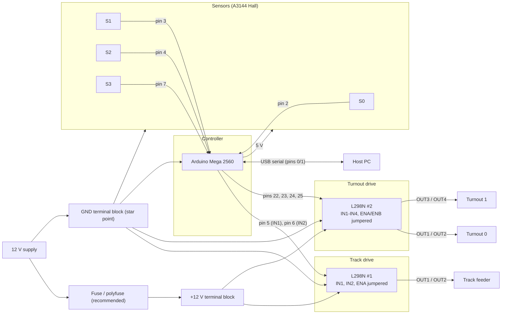

# Train Control System: Current Setup

N-gauge model railway controller built on an Arduino Mega 2560. It drives the track voltage and two turnouts, reads four Hall-effect sensors, and talks to an upstream controller over serial. Firmware: [train_control_sketch_001.ino](../train_control_sketch_001.ino).

## 1. Hardware

| Item | Qty | Role |
|---|---|---|
| Arduino Mega 2560 | 1 | Controller |
| L298N dual H-bridge module #1 | 1 | Track voltage (PWM, bidirectional) |
| L298N dual H-bridge module #2 | 1 | Turnout solenoids (brief polarity pulses) |
| A3144 Hall-effect sensor | 4 | Train detection (magnet on train) |
| Kato Unitrack and Kato solenoid turnouts | – | Layout |
| ~12 V DC supply | 1 | Powers both L298N modules |

## 2. Block diagram

## 3. Pin map

| Arduino pin | Function | Connected to | Label |
|---|---|---|---|
| 0 / 1 | USB serial (9600 baud) | Host PC | – |
| 2 | Sensor 0 (`INPUT_PULLUP`, active low) | A3144 #0 signal | `S0` |
| 3 | Sensor 1 | A3144 #1 signal | `S1` |
| 4 | Sensor 2 | A3144 #2 signal | `S2` |
| 7 | Sensor 3 | A3144 #3 signal | `S3` |
| 5 | Track forward PWM | L298N #1 IN1 | `TRK-IN1` |
| 6 | Track reverse PWM | L298N #1 IN2 | `TRK-IN2` |
| 22 | Turnout 0, side A | L298N #2 IN1 | `T0-A` |
| 23 | Turnout 0, side B | L298N #2 IN2 | `T0-B` |
| 24 | Turnout 1, side A | L298N #2 IN3 | `T1-A` |
| 25 | Turnout 1, side B | L298N #2 IN4 | `T1-B` |
| 5 V | Sensor supply | A3144 VCC (all four) | – |
| GND | Common ground | GND terminal block | – |

Sensor ID is the index in `PIN_SENSOR` (`{2, 3, 4, 7}`). Turnout ID is the index in `TURNOUT_PIN_A/B`.

## 4. Wiring table

| From | To | Notes |
|---|---|---|
| 12 V supply + | +12 V terminal block | Add a fuse (recommended) |
| +12 V terminal block | L298N #1 +12 V | |
| +12 V terminal block | L298N #2 +12 V | |
| 12 V supply − | GND terminal block | Star point |
| GND terminal block | L298N #1 GND | |
| GND terminal block | L298N #2 GND | |
| GND terminal block | Arduino GND | |
| GND terminal block | A3144 GND (all four) | |
| Arduino 5 V | A3144 VCC (all four) | |
| Arduino pin 5 | L298N #1 IN1 | |
| Arduino pin 6 | L298N #1 IN2 | |
| L298N #1 OUT1 / OUT2 | Track feeder | Rails A and B |
| Arduino pin 22 / 23 | L298N #2 IN1 / IN2 | |
| Arduino pin 24 / 25 | L298N #2 IN3 / IN4 | |
| L298N #2 OUT1 / OUT2 | Turnout 0 | |
| L298N #2 OUT3 / OUT4 | Turnout 1 | |
| A3144 #0 / #1 / #2 / #3 signal | Arduino pins 2 / 3 / 4 / 7 | Open-collector, internal pull-up used |

Module settings:
- Keep the ENA and ENB jumpers fitted on both L298N modules. No enable pin is driven by the Arduino.
- Leave the L298N 5 V terminals unconnected.

## 5. Firmware behaviour

### Track voltage
- The target voltage is set over serial as a signed 8-bit value, capped at ±`MAX_VOLTAGE` (128). In practice the signed byte limits it to ±127.
- The actual voltage ramps toward the target by 1 step every 100 ms (`VOLTAGE_CHANGE_RATE`, `VOLTAGE_UPDATE_INTERVAL`).
- Positive values: `analogWrite(5, v)` with pin 6 at 0. Negative values: pin 5 at 0 and `analogWrite(6, -v)`.
- A value of 127 is about 50% duty cycle, which gave roughly 6.7 V average on the track with a multimeter.
- Each change of the actual voltage is reported over serial as an actual-voltage message.

### PWM frequency
- The sketch sets Timer 3 and Timer 4 prescalers to `0b001`. The comment in the sketch says ~3.9 kHz, but this setting gives about 31 kHz on the Mega. A prescaler of `0b010` would give about 3.9 kHz.

### Turnouts
- A serial set message with value 0 or 1 starts a pulse in that direction.
- The pulse lasts 50 ms (`TURNOUT_PULSE_TIME`), then both inputs return to LOW.

### Sensors
- Each pin is read with `INPUT_PULLUP`. A LOW level means a magnet is detected.
- Changes are debounced for 50 ms (`SENSOR_DEBOUNCE_TIME`) and sent over serial as set messages.

### Serial protocol (9600 baud, 3 bytes per message)

| Byte | Contents |
|---|---|
| 0 | Message type (1 bit), device type (3 bits), device ID (4 bits) |
| 1 | Value (signed for voltage) |
| 2 | CRC8 (polynomial 0x07) over bytes 0 and 1 |

| Message type | Meaning |
|---|---|
| 0 | Query |
| 1 | Set |

| Device type | Meaning |
|---|---|
| 000 | Actual voltage (read-only) |
| 001 | Target voltage (write/read) |
| 010 | Block (reserved) |
| 011 | Sensor |
| 100 | Point direction (turnout), ID 0–1, value 0 or 1 |

Messages with a bad CRC are ignored. The track uses device ID 0.

## 6. Known issues and recommendations

- **Pull-downs:** Mega pins float during reset, so the L298N inputs can briefly be driven randomly. Add 10 kΩ pull-downs from each IN line (pins 5, 6, 22–25) to GND.
- **Fuse:** Add a fuse or polyfuse on the 12 V input.
- **Sensor wiring:** For long sensor wires, add an external 10 kΩ pull-up to 5 V and a 100 nF capacitor from signal to GND near the Arduino.
- **PWM frequency:** Correct the sketch comment, or change the prescaler if a lower frequency is wanted.
- **Common ground:** Keep all grounds joined at a single star point.

### Locomotive fault (Kato 10-1491S)
- The locomotive's motor stopped working while the lights stayed on. It also stayed dead on a Kato DC controller, so the fault is inside the locomotive.
- A contribution from PWM drive (brush arcing, low-speed stalling) cannot be ruled out, but the electrical levels are within the motor's rating, and a Kato 10-1898 runs normally on the same setup.
- Recommended checks: motor contacts and wiring, motor resistance across rotor positions, commutator and brushes. Contact the seller or Kato about warranty.

### Possible upgrade: smooth DC track supply
- A DAC (MCP4725) feeding an op-amp and a power transistor would replace the PWM track drive, with a DPDT relay for polarity. This is not built yet.
- Reserved pins for it: 20/21 (I2C) and 8 (relay).
